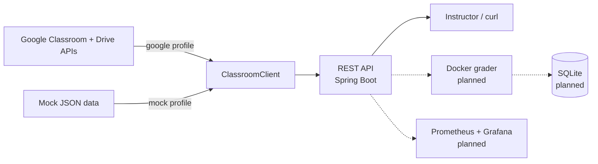

# AutoTA: An Auto-Grader for Java Submissions
[](https://github.com/htoor01/auto-ta/actions/workflows/ci.yml)

Documentation last updated on: `October 12, 2026`

This project was partially inspired by AutoLab, although no code from that open-source app was used.

A script-version was tested in a work environment with actual grades, while I was a TA at [Quakerbridge Learning Center](https://www.quaker-bridge.org/#/). It processed 200+ submissions and reduced the grading time of assignments from 3-6 hours to roughly 20-30 minutes. The project is now being rebuilt as a Spring Boot service with automated tests and CI. To simulate the original environment, local JSON files and mock data are provided.

> **Status:** Version 2 is in progress. It currently pulls courses, assignments and submissions from Google Classroom (or from mock data) through a REST API. Automated grading in Docker, persistence and metrics are next. See [Roadmap](#roadmap).

Future updates may include expanding to support other languages. Please see [Collaboration Guidelines](#collaboration-guidelines).

# Table of Contents

- [Set-Up Steps](#set-up-steps)
  - Installation prerequisites
  - How to run locally
  - Sample requests and expected responses
- [Project Overview](#project-overview)
  - [Architecture](#architecture)
  - [Project structure](#project-structure)
  - [Known limitations](#known-limitations)
  - [Roadmap](#roadmap)
  - [Version history](#version-history)
- [Collaboration Guidelines](#collaboration-guidelines)

# Set-Up Steps

1. Ensure Git is installed on your device. See <a href="https://git-scm.com/install/mac">Git Install documentation</a>. To verify, run `git version` in your terminal.

The result should be your version number. For example, "`git version 2.52.0`".

2. Clone this repository and move into it:

- `git clone https://github.com/htoor01/auto-ta.git`
- `cd auto-ta`

3. Install a JDK, version 25 or newer. Maven itself does not need to be installed: the included Maven Wrapper (`./mvnw`) downloads the right version on first use. Build and run the tests with `./mvnw verify`.

4. Run AutoTA with mock data (no Google account needed):

- `./mvnw spring-boot:run`
- `curl localhost:8080/api/courses` should return the sample course:

```json
[{"id":"course-java-2026","name":"Intro to Java","section":"2026 Batch","state":"ACTIVE"}]
```

- `curl localhost:8080/actuator/health` should return `{"status":"UP",...}`

| Endpoint | Returns |
|---|---|
| `GET /api/courses` | Active courses you teach |
| `GET /api/courses/{courseId}/coursework` | Assignments in a course |
| `GET /api/courses/{courseId}/coursework/{courseWorkId}/submissions` | Student submissions for an assignment |

Errors are returned as [RFC 9457](https://www.rfc-editor.org/rfc/rfc9457) problem responses. For example, `curl localhost:8080/api/courses/nope/coursework` returns:

```json
{"detail":"Course nope not found","instance":"/api/courses/nope/coursework","status":404,"title":"Not Found"}
```

The mock data (`src/main/resources/data/mock/`) contains one course, two assignments and five placeholder students (Student A to E). The four sample `Calculator.java` submissions are deliberately varied for the upcoming grader: one correct, one partially wrong, one that does not compile, and one with an infinite loop.

5. (Optional) Connect to real Google Classroom:

- In [Google Cloud Console](https://console.cloud.google.com/), create a project and enable the **Google Classroom API** and **Google Drive API**.
- Configure the OAuth consent screen and add your Google account as a test user.
- Create an OAuth client ID of type **Desktop app** and download its JSON.
- Save it as `secrets/credentials.json` in the project root. The `secrets/` folder is gitignored; never commit it.
- Run `./mvnw spring-boot:run -Dspring-boot.run.profiles=google`. A browser window opens for consent the first time; tokens are then cached in `tokens/` (also gitignored).

# Project Overview

Purpose:
To reduce feedback time for students and workload for teaching assistants (TAs). Chose against Google-native App Scripts so that I had more control over containerization (for untested student code) and CI pipelines (to learn about unit/integration tests).

Demo video: coming soon.

Workflow:
- ✅ Pull submissions from Google Classroom
- 🚧 Run JUnit tests against each submission in a Docker container
- 🚧 Evaluate and manually approve auto-grades in a web UI
- ✅ Instructor enters the approved grades in Google Classroom (automatic grade push is deferred, see [Known limitations](#known-limitations))

Concepts learned so far:
- RESTful APIs and OAuth 2.0
- Unit testing (JUnit 5, Mockito, Spring MVC tests)
- Dependency management (Maven, Maven Wrapper)
- Continuous integration (GitHub Actions)
- Version control (feature branches, pull requests, protected `main`)

## Architecture



Current:
- Java 25 and Spring Boot 4 (REST API, Actuator health check)
- Google Classroom and Drive APIs behind a `ClassroomClient` interface, so the real client and the mock client are swapped with a Spring profile (`google` or `mock`)
- JUnit 5 tests (18) for the clients, model mapping and REST layer
- Maven with the Maven Wrapper
- GitHub Actions CI: every pull request is built and tested, and `main` only accepts pull requests that pass

Planned:
- Docker containers to run JUnit tests against untested or malicious student code (no network, CPU/memory limits, timeout)
- SQLite for persistence, in case of app crash or work breaks
- Prometheus metrics and Grafana dashboards for grading throughput, duration and failures
- Web UI for approving grades

## Project structure

```
src/
  main/
    java/io/github/htoor01/autota/
      AutoTaApplication.java      entry point
      classroom/                  ClassroomClient interface, settings, errors
        google/                   real Google Classroom + Drive client, OAuth sign-in
        mock/                     mock client backed by local JSON
        model/                    Course, CourseWork, Submission, Attachment
      web/                        REST controller and error handling
    resources/
      application.yml             configuration (default profile: mock)
      data/mock/                  sample courses, assignments, submissions and files
  test/                           JUnit tests
.github/workflows/ci.yml          CI pipeline
.gitignore                        keeps secrets/, tokens/ and .env out of git
mvnw, .mvn/                       Maven Wrapper
pom.xml                           Maven dependencies
README.md                         this file
```

## Known limitations

- **Grades are not pushed back automatically.** Google Classroom only lets an app change grades on assignments created by the same Google Cloud project. Assignments created in the Classroom website reject grade updates, so for now the instructor enters approved grades manually.
- **Google sign-in works locally only.** The desktop OAuth flow opens a browser on the machine running AutoTA; a deployed server will need a web OAuth flow.
- **Only uploaded files are downloaded.** Submissions made as native Google Docs would need to be exported first, which is not supported yet. Uploaded `.java` files work.

## Roadmap

1. Grader: Docker image, instructor JUnit tests, sandboxed grading runner, grading endpoint
2. Persistence: grading runs and results in SQLite
3. Observability: Prometheus metrics and Grafana dashboards
4. Approval UI, including picking tests from a reusable test library
5. Pushing grades back to Classroom (creating assignments through the API)

## Version history

Version 1 of this project was developed for the [Quakerbridge Learning Center](https://www.quaker-bridge.org)'s 2026 Java Batch. It was a script with a basic JUnit testing suite and manual pulling of submissions, and is not part of this repository. Close to 200+ submissions were processed and autograded, reducing the average time for grading an assignment from 3-6 hours to roughly 20-30 minutes.

Version 2 (this repository) was mostly developed after the summer and is in progress. To simulate the original environment, local JSON files and mock data are used to mimic API responses and student data.

# Collaboration Guidelines

- Create a branch for each change and open a pull request into `main`.
- CI must pass ("Build and test") before a pull request can be merged.
- Never commit credentials: `secrets/`, `tokens/` and `.env` are gitignored.

Future updates may include supporting other languages like Python.
