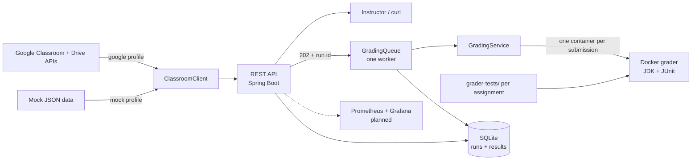

# Architecture

How AutoTA works inside, and why it is built this way. To install and run it, see the [setup guide](setup.md).

- [Overview](#overview)
- [Talking to Google Classroom](#talking-to-google-classroom)
- [Grading pipeline](#grading-pipeline)
- [Grading sandbox](#grading-sandbox)
- [Background grading and persistence](#background-grading-and-persistence)
- [Crash recovery](#crash-recovery)
- [Testing and CI](#testing-and-ci)
- [Project structure](#project-structure)
- [Known limitations](#known-limitations)
- [Roadmap](#roadmap)

## Overview



Stack: Java 25, Spring Boot 4 (REST API, Actuator), Spring JDBC with Flyway migrations on SQLite, Docker, JUnit 5/6, Maven Wrapper, GitHub Actions.

## Talking to Google Classroom

The rest of the app only knows the `ClassroomClient` interface (list courses, assignments and submissions; download an attachment). Two implementations are swapped with a Spring profile:

- `google`: the real Classroom and Drive APIs, signed in with the desktop OAuth flow. Google's model classes are converted to AutoTA's own records at the edge, so they never spread through the app.
- `mock` (the default): serves sample JSON and `.java` files from `src/main/resources/data/mock/`, so AutoTA runs and is tested without a Google account.

Classroom errors become [RFC 9457](https://www.rfc-editor.org/rfc/rfc9457) problem responses: `404` for missing resources, `403` when Google refuses permission, and `502` when Google itself fails (the request to AutoTA was fine; the service it depends on was not).

## Grading pipeline

For each submission, `GradingService`:

1. Downloads the attached `.java` files. File names come from students, so only plain names like `Calculator.java` are written to disk; anything else (paths, other file types) is skipped.
2. Starts a container from the grader image with the submission and the instructor tests from `grader-tests/<courseWorkId>/` mounted read-only.
3. Inside, `grade.sh` compiles everything and runs the JUnit console launcher, which writes a JUnit XML report.
4. Parses the report and scores it: tests passed ÷ tests run × the assignment's points, rounded to 2 decimals. Each test is worth the same share.
5. Deletes the submission's work folder.

One failing submission never stops the others: anything unexpected becomes that submission's `ERROR` result.

### Grading results

| Status | Meaning | Suggested grade |
|---|---|---|
| `GRADED` | Tests ran | Share of tests passed |
| `COMPILE_ERROR` | The submission (or the tests against it) did not compile; compiler output is in `detail` | 0 |
| `TIMEOUT` | The whole container hit its wall-clock limit | 0 |
| `NO_SUBMISSION` | No `.java` files attached | none |
| `ERROR` | AutoTA or Docker failed; says nothing about the student's work | none |

Every result is a suggestion: the instructor reviews and approves grades.

## Grading sandbox

Student code is untrusted, so every submission runs in a fresh container from `docker/grader`:

- **No network** (`--network none`), **no Linux capabilities** (`--cap-drop ALL`), `no-new-privileges`, and it runs as the `nobody` user.
- **Read-only filesystem.** The submission and the tests are mounted read-only; the only writable places are a small in-memory `/tmp` and the folder the report is written to.
- **Resource limits:** 512 MB memory with no swap, 1 CPU, at most 128 processes (stops fork bombs).
- **Two timeouts.** Each test gets 2 seconds, so an infinite loop fails only the test that triggers it (the sample infinite-loop submission scores 6/7). The whole container gets 60 seconds as a backstop; when it fires, the container is removed by name, because killing the `docker` command alone would leave it running.
- **Untrusted output.** The JUnit XML report is written next to student code, so it is parsed defensively: its size is capped and XML entities are disabled (no XXE).
- **Pinned image.** The JUnit launcher in the image is verified by checksum at build time.

## Background grading and persistence

`POST .../grade` validates the assignment while the request waits (so mistakes fail fast with `404`), saves a `QUEUED` run, and returns `202 Accepted` with a `Location` to poll. A single worker thread then grades the submissions one after another and saves each result as soon as it is ready.

Grading runs and results are stored in SQLite (`autota.db`), using plain Spring JDBC and a Flyway migration (`src/main/resources/db/migration/`). A run moves `QUEUED` → `RUNNING` → `COMPLETED`, or `FAILED` with a reason.

Trade-offs, chosen on purpose:

- **One worker, one container at a time.** Keeps the machine responsive and means SQLite has exactly one writer. Grading 30 submissions takes about 30 × 1-3 seconds.
- **A bounded queue.** Up to 10 runs wait behind the current one; beyond that, requests get `503` with `Retry-After` instead of an ever-growing backlog.
- **SQLite, single instance.** No database server to run, and WAL mode lets the API read while the worker writes. The cost: AutoTA cannot run as several instances sharing one database. Moving to PostgreSQL would mainly mean a new datasource URL and Flyway dialect, since the SQL is plain.
- **The database holds student names and grades**, so it is gitignored and should be treated as private.

## Crash recovery

If AutoTA stops mid-grade (crash, `kill -9`, power loss), the next start cleans up before accepting requests:

- Runs left `QUEUED` or `RUNNING` are marked `FAILED` ("AutoTA stopped before this run finished; grade again"). Results finished before the crash are kept.
- Containers labelled `autota.grader=true` that are still around are removed.
- Leftover work folders (which can hold student code) are deleted.

This was tested by killing the process with `kill -9` mid-run: the finished results survived, and the restart left no runs, containers or folders behind.

## Testing and CI

- **Unit tests** cover the Classroom clients and model mapping, the REST layer and error mapping, scoring and statuses, file-name filtering, report parsing (including the XXE case), the sandbox flags, storage against a real SQLite file, the queue (full queue, failures, restart recovery) and cleanup. Grading logic uses a fake container runner, so it needs no Docker.
- **Integration test** (`DockerGradingIT`, run by Maven Failsafe) grades the five sample submissions in real containers.
- **CI** (`.github/workflows/ci.yml`, job "Build and test") builds the grader image and runs everything on every pull request. It sets `AUTOTA_REQUIRE_DOCKER=true`, so a missing image fails the build instead of silently skipping the integration test. `main` is protected: pull requests need this check to pass.

## Project structure

```
src/
  main/
    java/io/github/htoor01/autota/
      AutoTaApplication.java      entry point
      classroom/                  ClassroomClient interface, settings, errors
        google/                   real Google Classroom + Drive client, OAuth sign-in
        mock/                     mock client backed by local JSON
        model/                    Course, CourseWork, Submission, Attachment
      grader/                     grading service and queue, Docker runner, report parser, storage
      web/                        REST controllers and error handling
    resources/
      application.yml             configuration (default profile: mock)
      db/migration/               Flyway schema
      data/mock/                  sample courses, assignments, submissions and files
  test/                           JUnit tests (*IT = needs Docker)
docker/grader/                    grader image: Dockerfile and grade.sh (compile + run tests)
grader-tests/                     instructor tests, one folder per assignment
docs/                             setup guide, architecture, logo
.github/workflows/ci.yml          CI pipeline
mvnw, .mvn/, pom.xml              Maven Wrapper and dependencies
```

## Known limitations

- **Grades are not pushed back automatically.** Google Classroom only lets an app change grades on assignments created by the same Google Cloud project. Assignments created in the Classroom website reject grade updates, so for now the instructor enters approved grades manually.
- **Google sign-in works locally only.** The desktop OAuth flow opens a browser on the machine running AutoTA; a deployed server will need a web OAuth flow.
- **Student code runs in the same JVM as the tests.** The sandbox protects the machine, but a determined student could, in principle, tamper with the test run itself (for example by writing a fake report). Instructor review of suggested grades is the safeguard for now.
- **Single instance.** One worker and SQLite mean one AutoTA process per database (see [trade-offs](#background-grading-and-persistence)).
- **Tests are equally weighted, Java only.** There is no per-test point value yet, and only `.java` attachments are graded.
- **Only uploaded files are downloaded.** Submissions made as native Google Docs would need to be exported first, which is not supported yet. Uploaded `.java` files work.

## Roadmap

1. ✅ Grader: Docker image, instructor JUnit tests, sandboxed grading runner, grading endpoint
2. ✅ Persistence: grading runs and results in SQLite, with grading as a background job and crash recovery
3. Observability: Prometheus metrics and Grafana dashboards (grading outcomes, container durations, queue depth)
4. Approval UI, including picking tests from a reusable test library
5. Pushing grades back to Classroom (creating assignments through the API)
